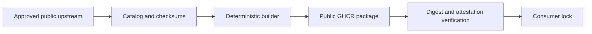

# CSOC public upstream mirrors

This personal public repository builds immutable OCI mirrors of approved public upstream software. It is not an Indiana University repository, service, or endorsement. It contains no institutional data, environment values, topology, rendered deployment manifests, credentials, kubeconfigs, private keys, receipts, or private repository content.

Published packages:

- `ghcr.io/jayadeyemi/csoc-public-bootstrap-bundle`
- `ghcr.io/jayadeyemi/csoc-public-charts/<chart>`

The catalogs record each upstream version, source, checksum, expected metadata, and redistribution license. `THIRD_PARTY_NOTICES.md` is generated from those catalogs. Original scripts and workflows are Apache-2.0 licensed; mirrored inputs retain their upstream licenses.

## Publication lifecycle

1. Scheduled discovery opens or refreshes a candidate pull request. It cannot merge or publish.
2. A maintainer reviews metadata, checksums, licenses, and rendered differences, then merges through protected `main`.
3. A maintainer manually dispatches publication from the exact `main` commit.
4. The protected `publish` environment has an explicit `PUBLICATION_ENABLED` circuit breaker. Publication is solo-controlled until a trusted reviewer is available; adding a reviewer and preventing self-review is the preferred future control.
5. A new package is inspected while private, then explicitly made public. Public visibility is treated as permanent.
6. The same workflow is rerun. It accepts only byte-identical content, verifies anonymous access and provenance, and emits a 14-day candidate lock.
7. Consumer repositories accept that lock through normal review.

Publication uses only the short-lived workflow `GITHUB_TOKEN`; it uses no PAT, deployment credential, repository secret, or private runner. Tags are labels. Consumers authorize exact OCI digests and verified GitHub provenance.

Run `make validate` for catalog, attribution, and unit validation. Run `make bundle` to create an ignored local review bundle.

## Account continuity

The owner maintains phishing-resistant 2FA, securely backed-up recovery codes, and periodic reviews of sessions and authorized applications. Until a trusted collaborator is available, recovery codes are the independent recovery path and publication remains manually dispatched. For an ownership change, verify the successor before removing the prior owner, rotate recovery methods, review Actions and package permissions, and verify an unchanged artifact publication before resuming updates.

## Architecture at a glance

This is the production GitHub.com checkout. Read the dated evidence register before describing its live state.

## Starting points

[Catalog sources](catalog/README.md) define approved public inputs; [artifact tooling](scripts/README.md) describes local validation and build review; [workflows](.github/workflows/README.md) explain protected publication. Run `make validate`, inspect generated notices and payload contents, and verify a published package by anonymous pull and provenance before a consumer updates its digest lock. Follow the nested `AGENTS.md` for catalog, scripts, and publication workflow changes.
